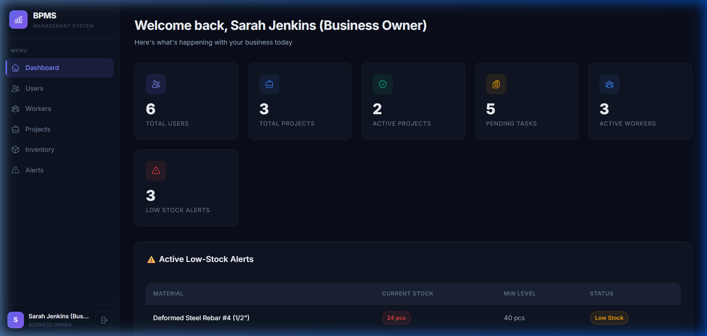
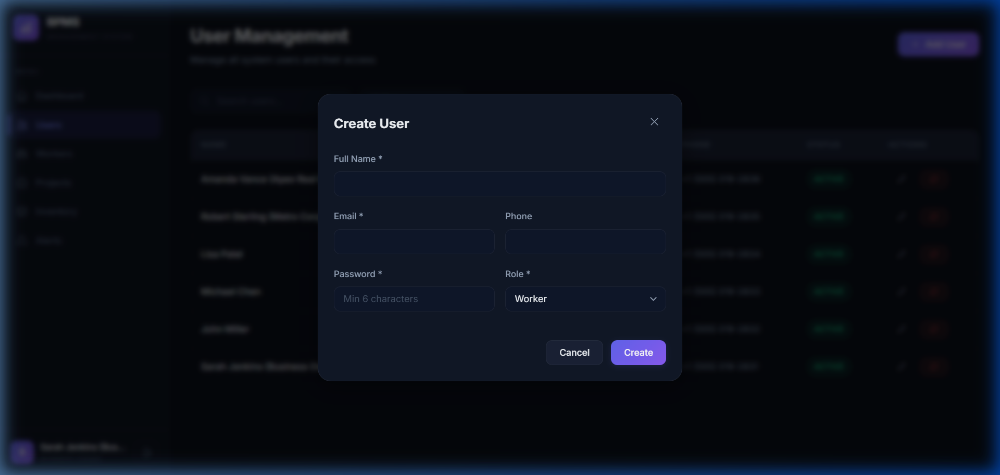
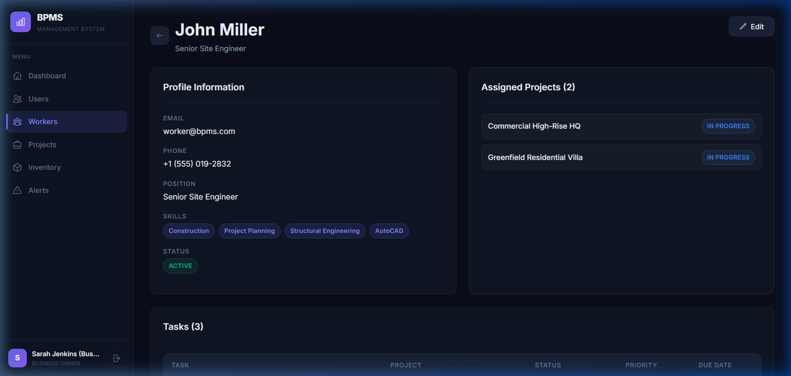
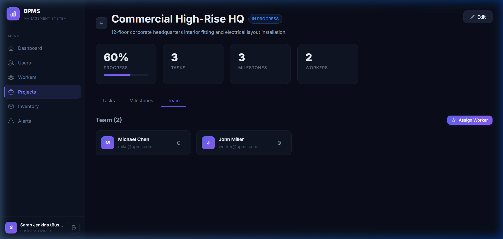
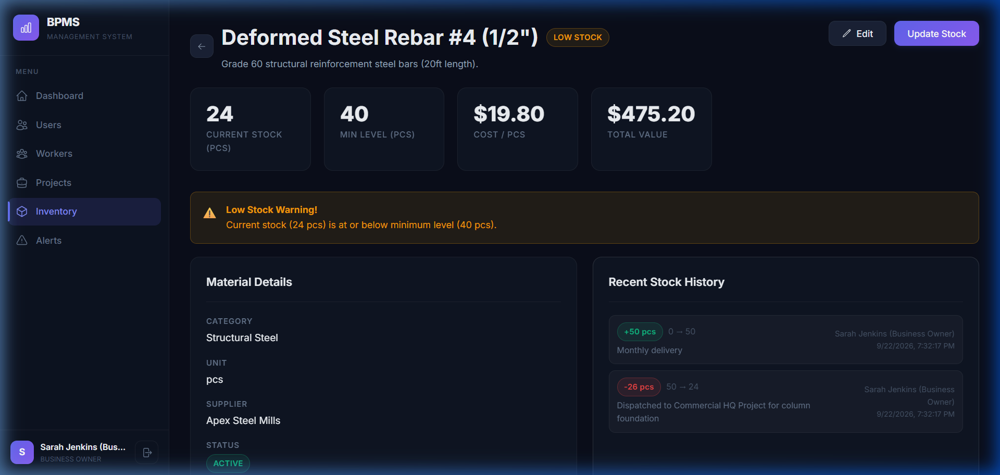
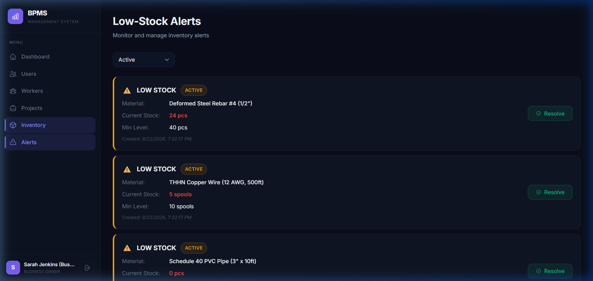

# 🌟 Business & Project Management System (BPMS)

> **A modern, full-stack Business and Project Management System built with React 19, Node.js/Express REST API, and Prisma ORM with SQLite. Implements core operational workflows for account access, workforce & project lifecycle tracking, and inventory materials management.**

[](https://react.dev/)
[](https://nodejs.org/)
[](https://expressjs.com/)
[](https://www.prisma.io/)
[](https://www.sqlite.org/)
[](https://vite.dev/)

---

## 🎥 Walkthrough Demo

Watch the complete end-to-end operational flow across all three modules in real time:


---

## 📸 Visual Showcase & Screen Demonstrations

| Dashboard Overview | User & Account Access Management |
| :---: | :---: |
|  |  |
| *Role-specific KPI cards, quick statistics, and urgent low-stock alert monitoring.* | *User account CRUD, search/filtering, role assignments, and modal actions.* |

| Workforce Directory & Worker Profiles | Project Hub & Team Assignments |
| :---: | :---: |
|  |  |
| *Skills taxonomy tagging, job roles, contact cards, and active assignments.* | *Multi-tab project cockpit: Task priorities, Milestones, and Assigned Team.* |

| Material Detail & Stock Transaction Audit | Automated Low-Stock Alert System |
| :---: | :---: |
|  |  |
| *Stock level indicators, unit costs, and complete ADD/DEDUCT audit trail.* | *Instant threshold trigger detection, alert status filters, and one-click resolution.* |

---

## ✨ Implemented Core Modules

The system provides complete, working functionality for the first three modules of the **DFD Level 1 architecture**:

### 1.0 Manage Accounts & Access
- **JWT Authentication**: Secure token-based session handling with bcrypt password hashing (cost factor 10+).
- **Role-Based Access Control (RBAC)**: Enforced via Express middleware and React route guards for three distinct personas:
  - 👑 **Business Owner**: Full administrative oversight across users, projects, workforce, inventory, and analytics.
  - 👷 **Worker**: Dedicated access to assigned projects, personalized task queues (`/my-tasks`), and profile details.
  - 🤝 **Client**: Read-only oversight of contracted projects and milestone progress.
- **Account Lifecycle Management**: Full user listing with search, filtering by role and status (`ACTIVE` / `INACTIVE`), account deactivation guards, and automated profile initialization for worker accounts.

### 2.0 Manage Workforce & Projects
- **Workforce Directory & Worker Profiles**: Structured tracking of worker positions, customizable skill arrays, active project counts, and direct contact details.
- **Project Cockpit**: Real-time project status indicators (`NOT_STARTED`, `IN_PROGRESS`, `ON_HOLD`, `COMPLETED`), start/end timeline management, and automatic completion progress calculation.
- **Task Management**:
  - Tasks categorized by priority levels (`LOW`, `MEDIUM`, `HIGH`, `URGENT`).
  - Worker assignments with status progression (`PENDING` ➔ `IN_PROGRESS` ➔ `COMPLETED`).
  - Completing tasks automatically recalculates the parent project's completion percentage.
- **Milestone Scheduling**: Milestone deadlines and status tracking to ensure stage-gate delivery.
- **Field Worker Portal (`/my-tasks`)**: Dedicated view for field workers to review assigned tasks and update status without accessing administrative settings.

### 3.0 Manage Inventory & Materials
- **Material Catalog**: Categorized material inventory with minimum stock thresholds, unit costs, stock counts, and supplier attribution.
- **Status Indicators**: Dynamic badge labels indicating stock health:
  - 🟢 `IN_STOCK`: Quantity safely above minimum threshold.
  - 🟡 `LOW_STOCK`: Quantity at or below safety stock level.
  - 🔴 `OUT_OF_STOCK`: Depleted inventory requiring urgent reorder.
- **Stock Transaction Log & Audit Trail**:
  - Inbound (`ADD`) and outbound (`DEDUCT`) inventory adjustments.
  - Deduction safety validation (prevents deducting more than available inventory).
  - Transaction logs capture exact quantities, timestamp, user attribution, and context notes.
- **Automated Low-Stock Alerts**:
  - Automatically raises active alerts whenever stock drops below threshold.
  - Dedicated alert dashboard (`/inventory/alerts`) with manual and automatic resolution upon restocking.

---

## 🛠️ Built With

- **Frontend**:
  - [React 19](https://react.dev/) — Modern component-driven UI
  - [Vite 8](https://vite.dev/) — Next-generation frontend tooling
  - [React Router 7](https://reactrouter.com/) — Declarative client routing and route guards
  - [React Icons (Heroicons 2)](https://react-icons.github.io/react-icons/) — Modern SVG iconography
  - [React Hot Toast](https://react-hot-toast.com/) — Fluid feedback notifications
  - Custom CSS Design System — Dark-mode glassmorphic styling, design tokens, and responsive layout
- **Backend**:
  - [Node.js](https://nodejs.org/) & [Express 5](https://expressjs.com/) — High-performance REST API
  - [Prisma ORM 5.22](https://www.prisma.io/) — Type-safe database queries and migrations
  - [SQLite](https://www.sqlite.org/) — Portable, zero-configuration embedded database
  - [Bcrypt.js](https://github.com/dcodeIO/bcrypt.js) — Password hashing
  - [JSON Web Token (jsonwebtoken)](https://jwt.io/) — Stateless authentication

---

## 🚀 Getting Started

### Prerequisites
- **Node.js** (v18 or higher recommended; tested on v24)
- **npm** (v9 or higher)

### Installation & Setup

1. **Clone the repository:**
   ```bash
   git clone https://github.com/username/bpms.git
   cd "Business & Project Management System (BPMS)"
   ```

2. **Configure and seed the backend database:**
   ```bash
   cd server
   npm install
   
   # Synchronize Prisma schema and seed initial production test data
   npm run db:push
   npm run db:seed
   ```

3. **Install frontend dependencies:**
   ```bash
   cd ../client
   npm install
   ```

---

## 💻 Running the Application

### 1. Start the Backend API (Port 5000)
```bash
cd server
npm run dev
```
> The API will be available at: `http://localhost:5000`  
> Health check endpoint: `http://localhost:5000/api/health`

### 2. Start the Frontend Client (Port 5173)
```bash
cd client
npm run dev
```
> The application will open at: `http://localhost:5173`

---

## 🔑 Default Login Credentials

The database comes pre-seeded with realistic production test data for all three roles:

| Role | Email | Password | Access Scope |
|---|---|---|---|
| 👑 **Business Owner** | `admin@bpms.com` | `admin123` | Full administrative control (All modules) |
| 👷 **Worker** | `worker@bpms.com` | `worker123` | Assigned projects, worker profile, `/my-tasks` |
| 🤝 **Client** | `client@bpms.com` | `client123` | Client dashboard & project milestone visibility |

---

## 📁 Repository Structure

```
.
├── client/
│   ├── src/
│   │   ├── components/         # Reusable UI (Modal, Sidebar, ProtectedRoute)
│   │   ├── contexts/           # Authentication state context (AuthContext)
│   │   ├── layouts/            # Dashboard layout shell
│   │   ├── pages/              # Module pages (Dashboard, Users, Workers, Projects, Inventory)
│   │   ├── services/           # Axios API service client
│   │   ├── index.css           # Design tokens, variables & glassmorphic utility classes
│   │   └── App.jsx             # Route definitions & RBAC gates
│   ├── index.html              # HTML entry point with metadata
│   └── vite.config.js          # Vite config with backend API reverse proxy
├── server/
│   ├── prisma/
│   │   ├── schema.prisma       # Prisma data model & SQLite datasource
│   │   ├── dev.db              # SQLite database file
│   │   └── seed.js             # Realistic test data seeder
│   └── src/
│       ├── middleware/         # Auth & RBAC validation middleware
│       ├── routes/             # REST endpoints (auth, users, workers, projects, materials)
│       ├── utils/              # Prisma client singleton
│       └── index.js            # Express server initialization
└── docs/
    └── screenshots/            # Walkthrough recording & interface captures
```

---

## 🤝 Contributing

Contributions, issues, and feature requests are welcome! Feel free to submit a pull request or open an issue.

---

## 📝 License

This project is licensed under the MIT License.
