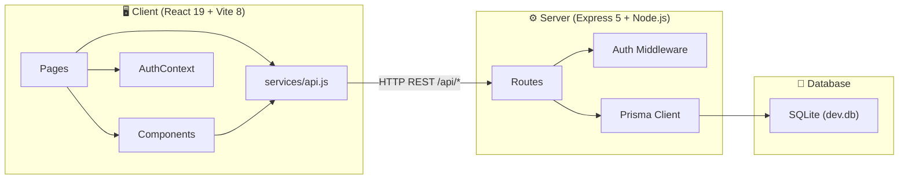

# 🏗️ BPMS — Full Project Structure Analysis

## Overview

**Business & Project Management System (BPMS)** is a full-stack monorepo application with a React 19 frontend and a Node.js/Express 5 backend, connected to an SQLite database via Prisma ORM. It implements 3 core business modules with role-based access for 3 user personas.

---

## Architecture Diagram



---

## Technology Stack

| Layer | Technology | Version |
|---|---|---|
| **Frontend Framework** | React | 19.2 |
| **Build Tool** | Vite | 8.3 |
| **Routing** | React Router DOM | 7.18 |
| **HTTP Client** | Axios | 1.20 |
| **Notifications** | React Hot Toast | 2.6 |
| **Icons** | React Icons (Heroicons 2) | 5.7 |
| **Linter** | OxLint | 1.81 |
| **Backend Runtime** | Node.js | 24+ |
| **Backend Framework** | Express | 5.2 |
| **ORM** | Prisma | 5.22 |
| **Database** | SQLite | 3 |
| **Auth** | JSON Web Tokens | 9.0 |
| **Password Hashing** | bcryptjs | 3.0 |

---

## Directory Tree

```
BUSINESS PROJECT MANAGEMENT SYSTEM/
├── 📄 README.md                         (11.8 KB — project docs & screenshots)
├── 📄 .gitignore
│
├── 📁 client/                           ← React SPA Frontend
│   ├── 📄 index.html                    (entry HTML)
│   ├── 📄 package.json                  (React 19, Vite 8, Axios, Router 7)
│   ├── 📄 vite.config.js               (dev proxy → localhost:5000)
│   ├── 📁 dist/                         (production build output)
│   ├── 📁 public/                       (static assets)
│   └── 📁 src/
│       ├── 📄 main.jsx                  (ReactDOM root mount)
│       ├── 📄 App.jsx                   (route definitions + RBAC gates)
│       ├── 📄 index.css                 (32 KB — full design system)
│       ├── 📁 assets/
│       ├── 📁 components/
│       │   ├── BrandLogo.jsx            (geometric SVG monogram)
│       │   ├── Modal.jsx                (reusable modal overlay)
│       │   ├── ProtectedRoute.jsx       (auth + role guard)
│       │   ├── Sidebar.jsx              (navigation sidebar)
│       │   └── Sidebar.css              (sidebar styles)
│       ├── 📁 contexts/
│       │   └── AuthContext.jsx          (JWT session + user state)
│       ├── 📁 layouts/
│       │   └── DashboardLayout.jsx      (sidebar + outlet shell)
│       ├── 📁 pages/                    ← 12 page components
│       │   ├── LoginPage.jsx            (auth login form)
│       │   ├── DashboardPage.jsx        (24 KB — role-specific dashboards)
│       │   ├── ProfilePage.jsx          (16 KB — profile + password mgmt)
│       │   ├── UsersPage.jsx            (user CRUD + search/filter)
│       │   ├── WorkersPage.jsx          (workforce directory)
│       │   ├── WorkerDetailPage.jsx     (worker profile details)
│       │   ├── ProjectsPage.jsx         (project listing)
│       │   ├── ProjectDetailPage.jsx    (47 KB — tasks, kanban, milestones, materials)
│       │   ├── MyTasksPage.jsx          (worker task portal)
│       │   ├── InventoryPage.jsx        (14 KB — material catalog)
│       │   ├── MaterialDetailPage.jsx   (stock mgmt + audit log)
│       │   └── AlertsPage.jsx           (low-stock alert dashboard)
│       └── 📁 services/
│           └── api.js                   (Axios client + interceptors + all API wrappers)
│
├── 📁 server/                           ← Express REST API Backend
│   ├── 📄 package.json                  (Express 5, Prisma, bcrypt, JWT)
│   ├── 📄 .env.example                  (env var template)
│   ├── 📁 prisma/
│   │   ├── schema.prisma               (10 models, full relations + indexes)
│   │   └── seed.js                      (12.8 KB — realistic test data)
│   └── 📁 src/
│       ├── 📄 index.js                  (Express app init, route mounting, error handler)
│       ├── 📁 middleware/
│       │   └── auth.js                  (JWT authenticate + role authorize)
│       ├── 📁 routes/                   ← 9 route modules
│       │   ├── auth.js                  (login, getMe, profile, password)
│       │   ├── users.js                 (CRUD + status toggle)
│       │   ├── workers.js               (profile + task views)
│       │   ├── projects.js              (CRUD + assignments + material allocation)
│       │   ├── tasks.js                 (CRUD + status progression + auto-progress)
│       │   ├── milestones.js            (CRUD + status tracking)
│       │   ├── materials.js             (CRUD + stock updates + audit trail)
│       │   ├── alerts.js                (low-stock alert lifecycle)
│       │   └── dashboard.js             (role-specific stats aggregation)
│       └── 📁 utils/
│           └── prisma.js                (PrismaClient singleton)
│
└── 📁 docs/
    └── 📁 screenshots/                  (walkthrough.webp + interface captures)
```

---

## Database Schema (10 Models)

```mermaid
erDiagram
    User ||--o| Worker : "has profile"
    User ||--o{ Project : "creates"
    User ||--o{ StockUpdate : "performs"

    Worker ||--o{ ProjectAssignment : "assigned to"
    Worker ||--o{ Task : "works on"

    Project ||--o{ Task : "contains"
    Project ||--o{ Milestone : "tracks"
    Project ||--o{ ProjectAssignment : "staffed by"
    Project ||--o{ ProjectMaterial : "consumes"

    Material ||--o{ StockUpdate : "tracked by"
    Material ||--o{ LowStockAlert : "triggers"
    Material ||--o{ ProjectMaterial : "allocated to"

    User {
        string id PK
        string fullName
        string email UK
        string password
        string role "BUSINESS_OWNER | WORKER | CLIENT"
        string status "ACTIVE | INACTIVE"
    }

    Worker {
        string id PK
        string userId FK_UK
        string position
        string skills "JSON array"
        string status
    }

    Project {
        string id PK
        string name
        string status "NOT_STARTED | IN_PROGRESS | ON_HOLD | COMPLETED"
        int progress "0-100"
        string createdById FK
    }

    Task {
        string id PK
        string title
        string status "PENDING | IN_PROGRESS | COMPLETED"
        string priority "LOW | MEDIUM | HIGH | URGENT"
        string projectId FK
        string assignedToId FK
    }

    Milestone {
        string id PK
        string title
        string status "PENDING | IN_PROGRESS | COMPLETED"
        string projectId FK
    }

    ProjectAssignment {
        string id PK
        string projectId FK
        string workerId FK
    }

    Material {
        string id PK
        string name
        string category
        int quantity
        int minStockLevel
        float costPerUnit
        string supplier
    }

    StockUpdate {
        string id PK
        string materialId FK
        string type "ADD | DEDUCT"
        int quantity
        int previousQty
        int newQty
        string createdById FK
    }

    LowStockAlert {
        string id PK
        string materialId FK
        string status "ACTIVE | RESOLVED"
    }

    ProjectMaterial {
        string id PK
        string projectId FK
        string materialId FK
        int quantity
    }
```

---

## Module Breakdown

### Module 1 — Manage Accounts & Access

| Feature | Frontend | Backend |
|---|---|---|
| JWT Login | [LoginPage.jsx](file:///p:/MY%20PROJECTS/AI%20ML/BUSINESS%20PROJECT%20MANAGEMENT%20SYSTEM/client/src/pages/LoginPage.jsx) | [auth.js](file:///p:/MY%20PROJECTS/AI%20ML/BUSINESS%20PROJECT%20MANAGEMENT%20SYSTEM/server/src/routes/auth.js) |
| Session Context | [AuthContext.jsx](file:///p:/MY%20PROJECTS/AI%20ML/BUSINESS%20PROJECT%20MANAGEMENT%20SYSTEM/client/src/contexts/AuthContext.jsx) | [auth middleware](file:///p:/MY%20PROJECTS/AI%20ML/BUSINESS%20PROJECT%20MANAGEMENT%20SYSTEM/server/src/middleware/auth.js) |
| Route Guards | [ProtectedRoute.jsx](file:///p:/MY%20PROJECTS/AI%20ML/BUSINESS%20PROJECT%20MANAGEMENT%20SYSTEM/client/src/components/ProtectedRoute.jsx) | `authorize()` middleware |
| User CRUD | [UsersPage.jsx](file:///p:/MY%20PROJECTS/AI%20ML/BUSINESS%20PROJECT%20MANAGEMENT%20SYSTEM/client/src/pages/UsersPage.jsx) | [users.js](file:///p:/MY%20PROJECTS/AI%20ML/BUSINESS%20PROJECT%20MANAGEMENT%20SYSTEM/server/src/routes/users.js) |
| Profile & Password | [ProfilePage.jsx](file:///p:/MY%20PROJECTS/AI%20ML/BUSINESS%20PROJECT%20MANAGEMENT%20SYSTEM/client/src/pages/ProfilePage.jsx) | `/auth/profile`, `/auth/change-password` |

### Module 2 — Manage Workforce & Projects

| Feature | Frontend | Backend |
|---|---|---|
| Workforce Directory | [WorkersPage.jsx](file:///p:/MY%20PROJECTS/AI%20ML/BUSINESS%20PROJECT%20MANAGEMENT%20SYSTEM/client/src/pages/WorkersPage.jsx) | [workers.js](file:///p:/MY%20PROJECTS/AI%20ML/BUSINESS%20PROJECT%20MANAGEMENT%20SYSTEM/server/src/routes/workers.js) |
| Worker Profile | [WorkerDetailPage.jsx](file:///p:/MY%20PROJECTS/AI%20ML/BUSINESS%20PROJECT%20MANAGEMENT%20SYSTEM/client/src/pages/WorkerDetailPage.jsx) | `GET /workers/:id` |
| Project CRUD + Kanban | [ProjectDetailPage.jsx](file:///p:/MY%20PROJECTS/AI%20ML/BUSINESS%20PROJECT%20MANAGEMENT%20SYSTEM/client/src/pages/ProjectDetailPage.jsx) | [projects.js](file:///p:/MY%20PROJECTS/AI%20ML/BUSINESS%20PROJECT%20MANAGEMENT%20SYSTEM/server/src/routes/projects.js) |
| Task Management | Embedded in ProjectDetail | [tasks.js](file:///p:/MY%20PROJECTS/AI%20ML/BUSINESS%20PROJECT%20MANAGEMENT%20SYSTEM/server/src/routes/tasks.js) |
| Milestone Tracking | Embedded in ProjectDetail | [milestones.js](file:///p:/MY%20PROJECTS/AI%20ML/BUSINESS%20PROJECT%20MANAGEMENT%20SYSTEM/server/src/routes/milestones.js) |
| Worker Task Portal | [MyTasksPage.jsx](file:///p:/MY%20PROJECTS/AI%20ML/BUSINESS%20PROJECT%20MANAGEMENT%20SYSTEM/client/src/pages/MyTasksPage.jsx) | `GET /workers/me/tasks` |

### Module 3 — Manage Inventory & Materials

| Feature | Frontend | Backend |
|---|---|---|
| Material Catalog | [InventoryPage.jsx](file:///p:/MY%20PROJECTS/AI%20ML/BUSINESS%20PROJECT%20MANAGEMENT%20SYSTEM/client/src/pages/InventoryPage.jsx) | [materials.js](file:///p:/MY%20PROJECTS/AI%20ML/BUSINESS%20PROJECT%20MANAGEMENT%20SYSTEM/server/src/routes/materials.js) |
| Stock Detail + Audit | [MaterialDetailPage.jsx](file:///p:/MY%20PROJECTS/AI%20ML/BUSINESS%20PROJECT%20MANAGEMENT%20SYSTEM/client/src/pages/MaterialDetailPage.jsx) | `GET /materials/:id/stock-history` |
| Low-Stock Alerts | [AlertsPage.jsx](file:///p:/MY%20PROJECTS/AI%20ML/BUSINESS%20PROJECT%20MANAGEMENT%20SYSTEM/client/src/pages/AlertsPage.jsx) | [alerts.js](file:///p:/MY%20PROJECTS/AI%20ML/BUSINESS%20PROJECT%20MANAGEMENT%20SYSTEM/server/src/routes/alerts.js) |
| Project Material Allocation | Via ProjectDetailPage | `POST /projects/:id/materials` |

---

## API Surface (9 Route Modules, ~40+ Endpoints)

| Route Prefix | Module | Key Endpoints |
|---|---|---|
| `/api/auth` | Auth | `POST /login`, `GET /me`, `PUT /profile`, `PUT /change-password` |
| `/api/users` | Accounts | `GET /`, `POST /`, `PUT /:id`, `PATCH /:id/status` |
| `/api/workers` | Workforce | `GET /`, `GET /:id`, `GET /me`, `GET /me/tasks`, `PUT /:id` |
| `/api/projects` | Projects | `GET /`, `POST /`, `PUT /:id`, assignments CRUD, materials allocation |
| `/api/tasks` | Tasks | `GET /`, `POST /`, `PATCH /:id`, `DELETE /:id` |
| `/api/milestones` | Milestones | `GET /`, `POST /`, `PATCH /:id`, `DELETE /:id` |
| `/api/materials` | Inventory | `GET /`, `POST /`, `PUT /:id`, `DELETE /:id`, `POST /:id/stock`, history |
| `/api/alerts` | Alerts | `GET /low-stock`, `PATCH /:id/resolve` |
| `/api/dashboard` | Dashboard | `GET /overview`, `GET /projects`, `GET /inventory` |

---

## RBAC Matrix

| Route / Feature | 👑 BUSINESS_OWNER | 👷 WORKER | 🤝 CLIENT |
|---|:---:|:---:|:---:|
| Dashboard | ✅ (full stats) | ✅ (my tasks) | ✅ (my projects) |
| Profile / Password | ✅ | ✅ | ✅ |
| User Management | ✅ | ❌ | ❌ |
| Workforce Directory | ✅ | ❌ | ❌ |
| Projects (list) | ✅ | ✅ (assigned) | ✅ (contracted) |
| Project Details | ✅ (full) | ✅ (read) | ✅ (read) |
| My Tasks Portal | ❌ | ✅ | ❌ |
| Inventory Management | ✅ | ❌ | ❌ |
| Low-Stock Alerts | ✅ | ❌ | ❌ |

---

## Key Architectural Patterns

| Pattern | Implementation |
|---|---|
| **Auth Flow** | JWT in `localStorage` → Axios interceptor attaches `Bearer` token → Express middleware verifies + hydrates `req.user` |
| **RBAC** | Dual-layer: frontend `<ProtectedRoute roles={[...]}/>` + backend `authorize('ROLE')` middleware |
| **State Management** | React Context (AuthContext) — no Redux/Zustand; page-local state via `useState` |
| **API Client** | Centralized Axios instance with request/response interceptors, organized by domain in [api.js](file:///p:/MY%20PROJECTS/AI%20ML/BUSINESS%20PROJECT%20MANAGEMENT%20SYSTEM/client/src/services/api.js) |
| **Database** | Prisma singleton in [prisma.js](file:///p:/MY%20PROJECTS/AI%20ML/BUSINESS%20PROJECT%20MANAGEMENT%20SYSTEM/server/src/utils/prisma.js), SQLite file-based DB — zero config |
| **Dev Proxy** | Vite proxies `/api` → `localhost:5000` to avoid CORS during development |
| **Styling** | Custom CSS design system (32KB) — dark-mode glassmorphic tokens, no Tailwind |
| **Module CJS** | Server uses CommonJS (`require/module.exports`); Client uses ES Modules |

---

## File Size Hotspots

| File | Size | Notes |
|---|---|---|
| [ProjectDetailPage.jsx](file:///p:/MY%20PROJECTS/AI%20ML/BUSINESS%20PROJECT%20MANAGEMENT%20SYSTEM/client/src/pages/ProjectDetailPage.jsx) | **47.5 KB** | Largest file — handles tasks (kanban + list), milestones, team, and materials tabs in one component |
| [index.css](file:///p:/MY%20PROJECTS/AI%20ML/BUSINESS%20PROJECT%20MANAGEMENT%20SYSTEM/client/src/index.css) | **32.6 KB** | Complete design system with tokens, utilities, component styles |
| [DashboardPage.jsx](file:///p:/MY%20PROJECTS/AI%20ML/BUSINESS%20PROJECT%20MANAGEMENT%20SYSTEM/client/src/pages/DashboardPage.jsx) | **24.0 KB** | Three separate role-specific dashboard renderers |
| [ProfilePage.jsx](file:///p:/MY%20PROJECTS/AI%20ML/BUSINESS%20PROJECT%20MANAGEMENT%20SYSTEM/client/src/pages/ProfilePage.jsx) | **16.4 KB** | Profile editing + password change + worker/owner info panels |
| [projects.js](file:///p:/MY%20PROJECTS/AI%20ML/BUSINESS%20PROJECT%20MANAGEMENT%20SYSTEM/server/src/routes/projects.js) | **14.0 KB** | Heaviest backend route — project CRUD + assignments + material allocation |
| [seed.js](file:///p:/MY%20PROJECTS/AI%20ML/BUSINESS%20PROJECT%20MANAGEMENT%20SYSTEM/server/prisma/seed.js) | **12.9 KB** | Comprehensive test data seeder |

> [!TIP]
> **`ProjectDetailPage.jsx` at 47KB is a prime candidate for refactoring** — it could be split into sub-components for each tab (Tasks, Milestones, Team, Materials) to improve maintainability.

---

## Strengths ✅

- **Clean monorepo separation** — client and server are fully decoupled
- **Well-defined Prisma schema** — proper indexes, cascade deletes, unique constraints
- **Dual-layer RBAC** — both frontend route guards AND backend middleware enforce roles
- **Comprehensive API client** — all endpoints organized by domain with interceptors
- **Self-contained design system** — custom CSS with no framework dependency
- **Realistic seed data** — production-like test data for all 3 roles
- **Cross-module integration** — inventory ↔ projects material allocation with audit trails

## Potential Improvements 🔧

| Area | Observation |
|---|---|
| **Large Components** | `ProjectDetailPage.jsx` (47KB) handles too many concerns — split into tab sub-components |
| **No Test Coverage** | No test files found (no Jest, Vitest, or testing-library setup) |
| **API URL Hardcoded** | [api.js](file:///p:/MY%20PROJECTS/AI%20ML/BUSINESS%20PROJECT%20MANAGEMENT%20SYSTEM/client/src/services/api.js#L3) hardcodes `localhost:5000` despite having a Vite proxy — could use relative URLs |
| **No Pagination** | List endpoints don't appear to support pagination for large datasets |
| **No Input Validation** | Server routes lack schema validation (e.g., Zod/Joi) before database operations |
| **Missing .env** | No `.env` file committed (expected); only `.env.example` exists — needs setup docs reminder |
| **CJS vs ESM** | Server uses CommonJS while client uses ESM — could unify to ESM throughout |
| **No Error Boundaries** | Client has no React Error Boundaries for graceful UI failure handling |

---

## How to Run

```bash
# 1. Backend setup
cd server
npm install
# Copy .env.example → .env and set JWT_SECRET + DATABASE_URL
npm run db:push
npm run db:seed
npm run dev          # → http://localhost:5000

# 2. Frontend
cd client
npm install
npm run dev          # → http://localhost:5173
```

**Default logins**: `admin@bpms.com` / `admin123` (Owner) · `worker@bpms.com` / `worker123` · `client@bpms.com` / `client123`
